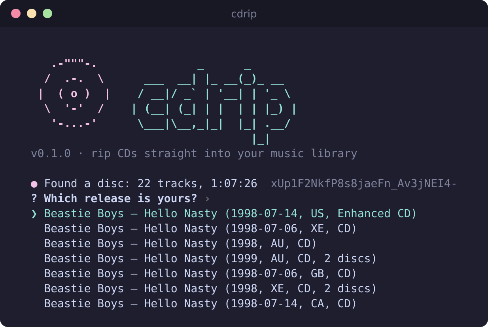

# cdrip

Rip audio CDs straight into your music library. Put a disc in, run `cdrip`, done.




- Looks the disc up on [MusicBrainz](https://musicbrainz.org) (artist, album, track titles, year)
- Rips with `cdparanoia` (error-correcting), encodes to FLAC, MP3 or Opus while ripping
- Tags every file and embeds the cover art from the Cover Art Archive
- Files land in `~/Music/Artist/Album (Year)/01 - Title.flac` next to a `cover.jpg`
- Skips tracks you already ripped, so re-running after a failure only redoes what's missing
- `--watch` mode: rip, eject, insert the next disc, repeat

## Install

```sh
sudo pacman -S cdparanoia flac          # plus `lame` for MP3, `opus-tools` for Opus
cargo install --path .
```

Linux only (it talks to the drive via `/dev/sr0`).

## Use

```sh
cdrip                    # rip the disc in the drive to ~/Music as FLAC
cdrip -f mp3             # MP3 V0 instead
cdrip -o /mnt/nas/music  # a different library folder
cdrip --watch --yes      # batch mode: no questions, just keep feeding it discs
```

Run `cdrip --help` for all options. Every option can also be set with an environment variable
(`CDRIP_MUSIC_DIR`, `CDRIP_FORMAT`, `CDRIP_DEVICE`).
